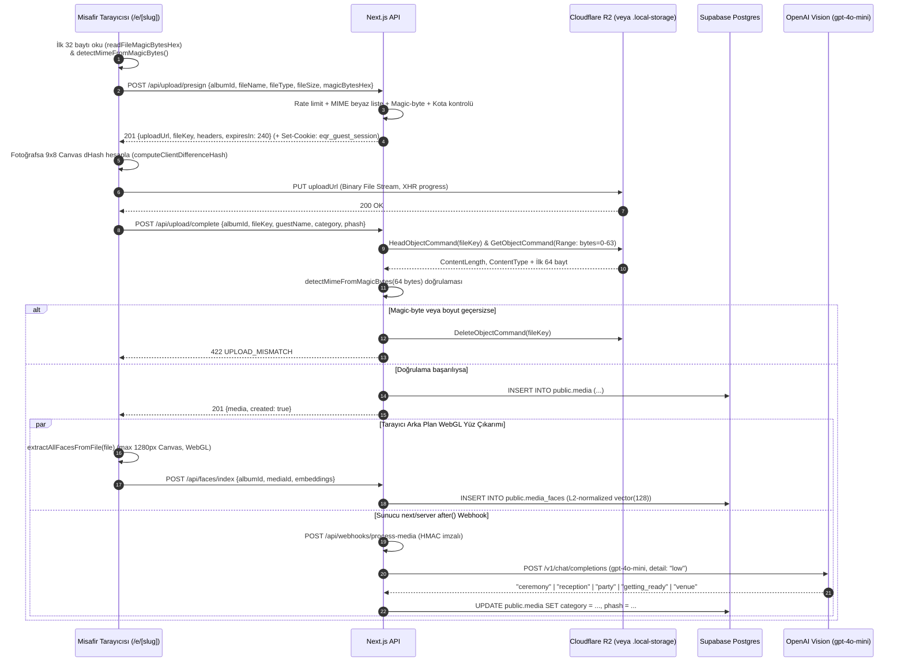

# API_AND_FLOWS.md — API Uç Noktaları, Yetkilendirme ve Kritik İş Akışları

## 1. Standart HTTP Yanıt ve Hata Sözleşmesi (`src/lib/api/http.ts`)

Tüm API rotaları `Cache-Control: no-store` başlığı ile yanıt döner.
- **Başarılı Yanıtlar:** `jsonOk<T>(body: T, status = 200)`
- **Hata Yanıtları:** `jsonError(status, code: ApiErrorCode, message, details?)`
  ```json
  {
    "error": {
      "code": "VALIDATION_FAILED",
      "message": "Request validation failed.",
      "details": {
        "slug": ["Slug must be 3–64 lowercase letters, numbers, or hyphens."]
      }
    }
  }
  ```
- **Tanımlı `ApiErrorCode` Değerleri (`src/types/database.ts`):**
  `BAD_REQUEST` | `VALIDATION_FAILED` | `UNAUTHORIZED` | `FORBIDDEN` | `NOT_FOUND` | `CONFLICT` | `RATE_LIMITED` | `QUOTA_EXCEEDED` | `ALBUM_NOT_FOUND` | `ALBUM_EXPIRED` | `ALBUM_LIMIT_REACHED` | `SLUG_TAKEN` | `FEATURE_DISABLED` | `UNSUPPORTED_MEDIA_TYPE` | `FILE_TOO_LARGE` | `UPLOAD_NOT_FOUND` | `UPLOAD_MISMATCH` | `INTERNAL_ERROR`.

---

## 2. Kimlik Doğrulama, Yetkilendirme ve Rate Limiting Matrisi

### 2.1. İki Farklı Kimlik Doğrulama Kanalı
1. **Ev Sahibi / Çift / Süper Admin (`src/lib/auth.ts`):**
   - `getAuthenticatedActor()`: `@supabase/ssr` çerezlerinden aktif kullanıcıyı (`auth.getUser()`) okur ve `profiles.is_super_admin` veya `user.app_metadata.is_super_admin` kontrolü yapar.
   - `verifyAlbumManagerAccess(albumId, actor)`: Kullanıcının `albums.owner_id === actor.userId`, `actor.isSuperAdmin === true` veya `co_hosts` tablosunda `email === actor.email` olup olmadığını doğrular.
2. **Anonim Misafir (`src/lib/guest-session.ts`):**
   - `resolveOrMintGuestSession(request)` / `getVerifiedGuestSession(request)`: `eqr_guest_session` (`HttpOnly`, `SameSite=Lax`, 90 gün ömürlü) çerezini veya `x-guest-session-token` başlığını `HMAC-SHA256` (`timingSafeEqual`) ile doğrular.

### 2.2. Uç Nokta Bazlı Hız Sınırları (`src/lib/rate-limit.ts`)

| Namespace | Uç Nokta | Limit / Pencere | Anahtar (`bucketKey`) |
| :--- | :--- | :--- | :--- |
| `events:get` | `GET /api/events/[slug]` | `90 istek / 60 sn` | `events:get:{ip}` |
| `events:register` | `POST /api/events/[slug]` | `20 istek / 60 sn` | `events:register:{ip}:{sessionId}` |
| `events:delete` | `DELETE /api/events/[slug]` | `30 istek / 60 sn` | `events:delete:{ip}:{sessionId}` |
| `upload:presign` | `POST /api/upload/presign` | `60 istek / 60 sn` | `upload:presign:{ip}:{sessionId}` |
| `upload:complete` | `POST /api/upload/complete` | `60 istek / 60 sn` | `upload:complete:{ip}:{sessionId}` |
| `faces:index` | `POST /api/faces/index` | `30 istek / 60 sn` | `faces:index:{ip}:{sessionId}` |
| `faces:match` | `POST /api/faces/match` | `15 istek / 60 sn` | `faces:match:{ip}:{sessionId}` |
| `album:zip` | `GET /api/albums/[albumId]/download` | `6 istek / 60 sn` | `album:zip:{ip}:{userId}` |
| `webhook:process-media` | `POST /api/webhooks/process-media` | `60 istek / 60 sn` | `webhook:process-media:{ip}` |
| `storage:put` | `PUT /api/storage/[...fileKey]` | `90 istek / 60 sn` | `storage:put:{ip}` |
| `storage:get` | `GET /api/storage/[...fileKey]` | `180 istek / 60 sn` | `storage:get:{ip}` |

---

## 3. Tüm API Uç Noktaları Referansı

### 3.1. Misafir Etkinlik ve Yükleme API'leri

#### `GET /api/events/[slug]`
- **Dosya:** `src/app/api/events/[slug]/route.ts`
- **Amaç:** Misafir QR sayfasını başlatır. Albümün genel ayarlarını (`PublicAlbum`), galeri kilit durumunu (`isGalleryLocked`, `lockReason: "private" | "disposable_camera" | null`) ve **yalnızca** doğrulanmış `eqr_guest_session` çerezine sahip misafirin kendi yüklediği medyaları (`myUploads` — her biri için `< 300s` imzalı GET URL'i üretilir) ve kayıt bilgilerini (`registration`) döner. Yanıta `eqr_guest_session` çerezini ekler.

#### `POST /api/events/[slug]`
- **Dosya:** `src/app/api/events/[slug]/route.ts`
- **İstek Gövdesi (`8 KB` sınır):**
  ```typescript
  {
    guestSessionId?: string;
    guestName?: string | null;     // max 80 karakter
    contact?: string | null;       // max 160 karakter (E-posta veya WhatsApp)
    tableNumber?: string | null;   // max 32 karakter
    contactConsent?: boolean;      // contact doluysa true olmak ZORUNDADIR (GDPR/KVKK)
  }
  ```
- **Yanıt (`201 Created`):** `{ registered: true, albumId: UUID, guestSessionId: string }`

#### `DELETE /api/events/[slug]`
- **Dosya:** `src/app/api/events/[slug]/route.ts`
- **İstek Gövdesi:** `{ mediaId: UUID, guestSessionId?: string }`
- **Güvenlik:** Yalnızca `eqr_guest_session` çerezindeki `sessionId` ile `media.guest_session_id` birebir eşleşirse hem R2 nesnesini hem de `public.media` satırını siler.

#### `POST /api/upload/presign`
- **Dosya:** `src/app/api/upload/presign/route.ts`
- **İstek Gövdesi (`presignUploadRequestSchema`):**
  ```typescript
  {
    albumId: UUID;
    fileName: string;        // 1..255 karakter, kontrol karakterleri temizlenir
    fileType: string;        // Örn. "image/jpeg", "video/mp4", "audio/webm;codecs=opus"
    fileSize: number;        // Pozitif tam sayı (bayt)
    magicBytesHex?: string;  // İlk 32 baytın hex karşılığı (8..128 hex karakter)
  }
  ```
- **Yanıt (`201 Created` — `PresignUploadResponse`):**
  ```typescript
  {
    uploadUrl: string;       // R2 Presigned PUT URL veya /api/storage/... imzalı yerel URL
    method: "PUT";
    headers: { "Content-Type": string };
    fileKey: string;         // "albums/{albumId}/{uuid}.{ext}"
    publicUrl: string;
    mediaType: "photo" | "video" | "audio";
    expiresIn: number;       // 240 saniye (< 300s)
    expiresAt: Timestamp;
  }
  ```

#### `POST /api/upload/complete`
- **Dosya:** `src/app/api/upload/complete/route.ts`
- **İstek Gövdesi (`completeUploadRequestSchema`):**
  ```typescript
  {
    albumId: UUID;
    fileKey: string;         // isFileKeyForAlbum(fileKey, albumId) ile doğrulanır
    guestName?: string | null;
    guestSessionId?: string | null;
    category?: MediaCategory; // varsayılan: "general"
    phash?: string | null;    // 16 hex karakter (^[0-9a-f]{16}$)
  }
  ```
- **İşleyiş:**
  1. `file_key` daha önce kaydedilmişse idempotent olarak mevcut satırı (`{ media, created: false }`) döner.
  2. `headR2Object(fileKey)` ile nesnenin varlığını, gerçek boyutunu ve MIME tipini kontrol eder.
  3. `readR2ObjectMagicBytes(fileKey, 64)` ile R2'deki dosyanın ilk 64 baytını okur ve `detectMimeFromMagicBytes` ile sahte uzantı/MIME saldırılarını engeller. Başarısız olursa `discardObject(fileKey)` ile dosyayı R2'den siler ve `422 UPLOAD_MISMATCH` döner.
  4. `public.media` tablosuna satırı ekler. Eğer `media_type === "photo"` ise `after()` ile `/api/webhooks/process-media` uç noktasını tetikler.

---

### 3.2. Biyometrik Yüz Tanıma API'leri

#### `POST /api/faces/index`
- **Dosya:** `src/app/api/faces/index/route.ts`
- **İstek Gövdesi (`128 KB` sınır):** `{ albumId: UUID, mediaId: UUID, embeddings: number[][] }` (1..25 adet 128-elemanlı sonlu sayı dizisi).
- **Anti-Poisoning Korumaları:**
  - Çağıran kişi ya fotoğrafı yükleyen `eqr_guest_session` sahibi olmalı **ve** fotoğraf son **15 dakika** (`MAX_INDEX_WINDOW_MS = 15 * 60 * 1000`) içinde yüklenmiş olmalı ya da albüm yöneticisi (`verifyAlbumManagerAccess`) olmalıdır.
  - Aynı `mediaId` için `media_faces` tablosunda zaten kayıt varsa `409 CONFLICT` döner (tekrarlı vektör zehirlemesini önler).
  - Her vektör `toVectorString` (`src/lib/vector.ts`) ile L2-normalize edilerek kaydedilir.

#### `POST /api/faces/match`
- **Dosya:** `src/app/api/faces/match/route.ts`
- **İstek Gövdesi (`32 KB` sınır):** `{ albumId: UUID, embedding: number[], threshold?: number }`
- **İşleyiş:** Eşik değerini `[0.78, 0.99]` aralığına sıkıştırır (varsayılan `0.82`). Albümün süresi dolmamışsa, `enableFaceRecognition` açıksa ve galeri kilitli değilse (`privacy_mode !== "private"` ve `reveal_at` geçmişse) `match_guest_faces` RPC'sini çağırır. Dönen her eşleşme için `createPresignedGetUrl` ile kısa ömürlü imzalı URL üretir ve `guest_name: null` olarak döner.

---

### 3.3. Çift (Host) ve Süper Admin API'leri

| Metod & Uç Nokta | Dosya | Yetki | Açıklama |
| :--- | :--- | :--- | :--- |
| `GET /api/albums` | `src/app/api/albums/route.ts` | Authenticated / Demo | Kullanıcının sahibi olduğu veya `co_hosts` olduğu albümleri listeler. |
| `POST /api/albums` | `src/app/api/albums/route.ts` | Authenticated | Yeni albüm oluşturur (hesap başı max 5; `cloneFromAlbumId` varsa tema/akış kopyalar). |
| `GET /api/albums/[albumId]` | `src/app/api/albums/[albumId]/route.ts` | Album Manager | Albüm detayını, tüm medyaları (gizliler dahil), `coHosts` ve `guestRegistrations` listesini döner. |
| `PATCH /api/albums/[albumId]` | `src/app/api/albums/[albumId]/route.ts` | Album Manager (Co-host ekleme/silme: sadece Owner/SuperAdmin) | Albüm ayarlarını (`title`, `slug`, `eventDate`, `privacyMode`, `revealAt`, `themeConfig`, `flowConfig`), co-host davetlerini (`addCoHostEmail`, `removeCoHostId`) ve toplu medya moderasyonunu (`hideMediaIds`, `unhideMediaIds`, `recategorizeMedia`) günceller. |
| `DELETE /api/albums/[albumId]` | `src/app/api/albums/[albumId]/route.ts` | Album Manager | Seçili `mediaIds` (1..200 adet) dosyalarını önce R2'den (`deleteR2Object`), ardından `public.media` tablosundan kalıcı olarak siler. |
| `GET /api/albums/[albumId]/download` | `src/app/api/albums/[albumId]/download/route.ts` | Album Manager | Kategori klasörlerine (`Ceremony/`, `Party/`, `Voice_Toasts/` vb.) ayrılmış sıfır-RAM akışlı (`PassThrough`) ZIP arşivi indirir. Opsiyonel `?category=...` ve `?includeHidden=true` destekler. |
| `GET /api/admin/events` | `src/app/api/admin/events/route.ts` | Authenticated (SuperAdmin tümünü, Owner kendininkini görür) | Tüm etkinliklerin medya, R2 depolama baytı, indekslenen yüz ve misafir kayıt metriklerini (`AdminEventMetric[]`) döner. |
| `PATCH /api/admin/events` | `src/app/api/admin/events/route.ts` | Super Admin | `{ albumId, isPaid, planTier }` ile manuel VIP ödeme aktivasyonu ve 24 ay süre uzatımı yapar. |
| `POST /api/admin/events` | `src/app/api/admin/events/route.ts` | Authenticated / Super Admin | `{ sourceAlbumId, title, slug, eventDate }` ile mevcut bir etkinliğin `theme_config` ve `flow_config` ayarlarını yeni bir etkinliğe klonlar. |
| `DELETE /api/admin/events` | `src/app/api/admin/events/route.ts` | Super Admin | Albüme ait tüm R2 medya dosyalarını temizler ve albümü (`CASCADE` ile tüm alt tabloları) kalıcı olarak siler. |

---

### 3.4. Ödeme, Webhook ve Yerel Depolama API'leri

| Metod & Uç Nokta | Dosya | Yetki / İmza | Açıklama |
| :--- | :--- | :--- | :--- |
| `POST /api/checkout` | `src/app/api/checkout/route.ts` | Album Manager | `STRIPE_SECRET_KEY` varsa Stripe Checkout oturumu açar (`mode: "stripe"`). Yoksa imzalı bir `checkout.session.completed` olayını `/api/webhooks/payment`'a gönderir (`mode: "simulated_signed"`). |
| `POST /api/webhooks/payment` | `src/app/api/webhooks/payment/route.ts` | `Stripe-Signature` veya `X-Webhook-Signature` (HMAC-SHA256, 300s pencere) | `albums.is_paid = true`, `plan_tier` ve `expires_at` (24 ay) alanlarını günceller. |
| `POST /api/webhooks/process-media` | `src/app/api/webhooks/process-media/route.ts` | `X-Internal-Webhook-Signature` veya doğrulanmış `eqr_guest_session` | Hem doğrudan `{ mediaId, albumId, fileUrl, clientPhash }` yükünü hem de Supabase Database Webhook (`type: "INSERT", table: "media"`) yükünü destekler. SSRF'i önlemek için `fileUrl` yerine veritabanındaki kanonik `currentMedia.file_url` değerini kullanır, OpenAI `gpt-4o-mini` Vision ile kategorize eder ve `hammingDistance64 <= 10` ile kopya tespiti yapar. |
| `PUT / GET /api/storage/[...fileKey]` | `src/app/api/storage/[...fileKey]/route.ts` | Query param HMAC-SHA256 (`exp`, `len`, `type`, `sig`) | Cloudflare R2 yapılandırılmadığında devreye giren yerel imzalı nesne depolama uç noktasıdır. |

---

## 4. Kritik İş Akışı Diyagramları (Sequence Diagrams)

### 4.1. Doğrudan R2 Medya Yükleme, Magic-Byte Doğrulama ve Arka Plan AI İşleme Akışı



---

## 5. Gelecek AI Ajanları İçin Kritik API ve İş Akışı Uyarıları

> [!CAUTION]
> **SSRF Koruması (`/api/webhooks/process-media`):**
> `POST /api/webhooks/process-media` gövdesinde `fileUrl` alanı gelse bile, sunucu OpenAI'a veya `fetch()` fonksiyonuna göndermeden önce veritabanından `currentMedia.file_url` değerini okur (`const canonicalFileUrl = currentMedia.file_url;`). Saldırganların iç ağ URL'lerini taramasını (SSRF) önlemek için asla doğrudan istek gövdesindeki `fileUrl` adresine sunucudan `fetch` atmayın!

> [!WARNING]
> **15 Dakikalık Yüz İndeksleme Penceresi (`/api/faces/index`):**
> Anonim bir misafir oturumu, yüklediği bir fotoğraf için yalnızca `media.created_at` zamanından itibaren **15 dakika** (`MAX_INDEX_WINDOW_MS = 15 * 60 * 1000`) içinde ve yalnızca **1 kez** (`existingCount === 0`) yüz vektörü indeksleyebilir. Bu kural, kötü niyetli bir istemcinin eski fotoğraflara sahte yüz vektörleri enjekte ederek diğer misafirlerin "Find Me" sonuçlarını kirletmesini (vector table poisoning) engeller.

> [!IMPORTANT]
> **Presigned URL Süresi Sınırı (`< 300s`):**
> `src/lib/media-config.ts` içinde `PRESIGN_TTL_SECONDS = 240` ve `MAX_PRESIGN_TTL_SECONDS = 299` olarak sabitlenmiştir. Güvenlik mandatı gereği hiçbir presigned `PUT` veya `GET` URL'inin geçerlilik süresi 300 saniyeyi aşmamalıdır.
