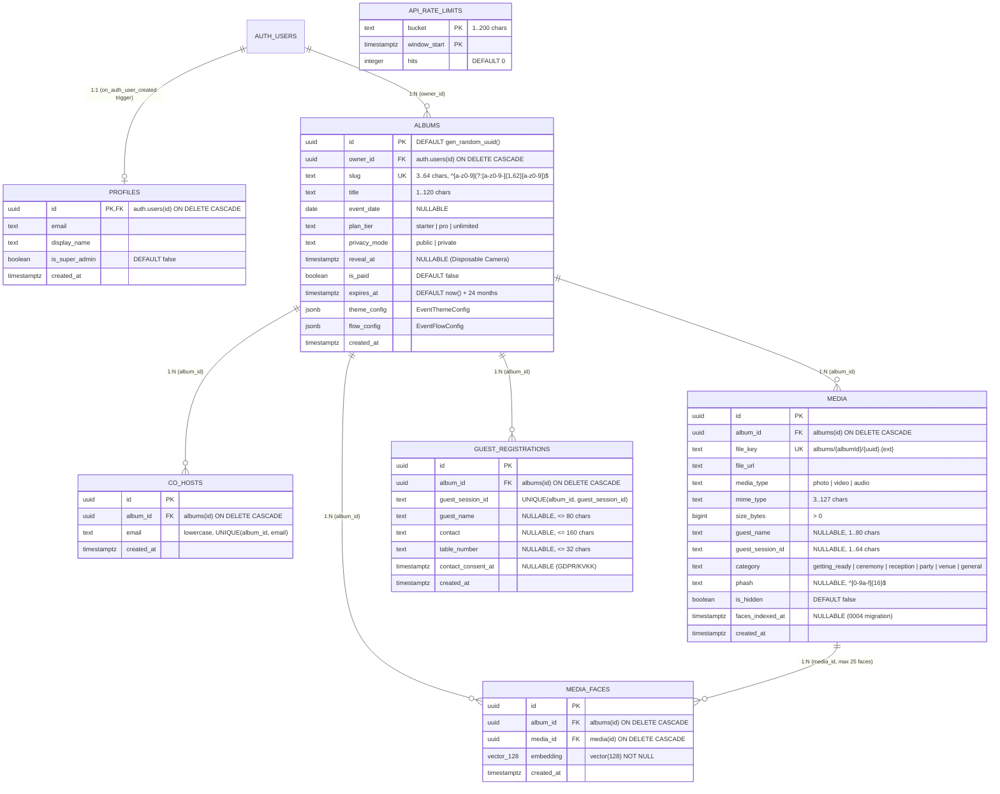

# DATA_MODELS.md — Veri Tabanı Şeması, Varlıklar, İlişkiler ve DTO Yapıları

## 1. İlişkisel Veri Tabanı Şeması (ER Diyagramı)

Veri tabanı şeması `supabase/migrations/0001_init_schema.sql` ile `0004_private_biometric_gallery.sql` arasındaki 4 sıralı göç dosyasından oluşur ve `pgvector` eklentisini (`create extension if not exists vector;`) kullanır.



---

## 2. Tablo Detayları, Kısıtlamalar (Constraints) ve İndeksler

### 2.1. `public.profiles` (`src/types/database.ts` -> `Profile`)
- **Oluşturulma:** `auth.users` tablosuna yeni bir kullanıcı eklendiğinde `on_auth_user_created` tetikleyicisi (`public.handle_new_auth_user()`) otomatik olarak `profiles` satırını oluşturur.
- **Yetki Kuralı:** `is_super_admin` sütunu üzerinde `authenticated` rolünün `UPDATE` yetkisi geri alınmıştır (`revoke insert, update on public.profiles from anon, authenticated; grant update (display_name) on public.profiles to authenticated;`). Yalnızca `service_role` değiştirebilir.

### 2.2. `public.albums` (`src/types/database.ts` -> `Album`)
- **Kritik Sütunlar:**
  - `slug`: Benzersiz (`albums_slug_key`), küçük harf ASCII ve tire formatında (`^[a-z0-9](?:[a-z0-9-]{1,62}[a-z0-9])$`).
  - `plan_tier`: `'starter' | 'pro' | 'unlimited'`.
  - `privacy_mode`: `'public'` (Biyometrik Yüz Kapısı aktif) veya `'private'` (Yalnızca çift/yöneticiler görebilir, misafirler yalnızca yükleme yapabilir).
  - `reveal_at`: Doluysa ve `reveal_at > now()` ise **Disposable Camera Mode** aktiftir; misafirler yükleme yapabilir ancak yüz eşleştirme galerisi kilitlidir.
  - `theme_config` (`jsonb`): `EventThemeConfig` nesnesi.
  - `flow_config` (`jsonb`): `EventFlowConfig` nesnesi.
- **Tetikleyici Koruması (`trg_guard_album_billing_columns`):**
  - `public.guard_album_billing_columns()` fonksiyonu, `is_paid`, `plan_tier` veya `expires_at` sütunları değiştiğinde çağrıyı yapanın `public.is_trusted_server()` veya `public.is_super_admin()` olmasını zorunlu kılar; aksi halde `42501: FORBIDDEN_BILLING_UPDATE` hatası fırlatır.
- **İndeksler:** `albums_slug_key` (UNIQUE btree), `albums_owner_id_idx` (`owner_id`).

### 2.3. `public.co_hosts` (`src/types/database.ts` -> `CoHost`)
- **Kısıtlamalar:** `UNIQUE (album_id, email)`, e-posta küçük harf ve boşluksuz olmalıdır (`email = lower(btrim(email))`).
- **İndeksler:** `co_hosts_album_email_key`, `co_hosts_email_idx`.

### 2.4. `public.media` (`src/types/database.ts` -> `Media`)
- **Kritik Sütunlar:**
  - `file_key`: Benzersiz (`media_file_key_key`), sunucu tarafından üretilen kanonik R2 anahtarı (`albums/{albumId}/{uuid}.{ext}`).
  - `media_type`: `'photo' | 'video' | 'audio'`.
  - `category`: `'getting_ready' | 'ceremony' | 'reception' | 'party' | 'venue' | 'general'`.
  - `phash`: 16 karakterlik onaltılık (`^[0-9a-f]{16}$`) 64-bit algısal özet.
  - `is_hidden`: Moderasyon durumu (`flow_config.features.requireModerationBeforePublic` açıksa yükleme anında `true` olarak başlar).
- **İndeksler:**
  - `media_album_id_idx` (`album_id`)
  - `media_album_visible_created_idx` (`album_id, created_at desc WHERE NOT is_hidden`)
  - `media_album_session_idx` (`album_id, guest_session_id WHERE guest_session_id IS NOT NULL`)
  - `media_album_phash_idx` (`album_id, phash WHERE phash IS NOT NULL`)

### 2.5. `public.media_faces` (`src/types/database.ts` -> `MediaFace`)
- **Kritik Sütunlar:**
  - `embedding`: `vector(128) not null` (L2-normalize edilmiş 128-boyutlu yüz vektörü).
- **Tetikleyici Koruması (`trg_enforce_media_faces_cap`):**
  - `public.enforce_media_faces_cap()` fonksiyonu, tek bir `media_id` için en fazla **25 yüz** kaydedilmesine izin verir (`>= 25` ise `P0001: MEDIA_FACES_CAP_REACHED` hatası fırlatır).
- **İndeksler:**
  - `media_faces_album_id_idx` (`album_id`)
  - `media_faces_media_id_idx` (`media_id`)
  - `media_faces_embedding_hnsw_idx` (`USING hnsw (embedding vector_cosine_ops)`)

### 2.6. `public.guest_registrations` (`src/types/database.ts` -> `GuestRegistration`)
- **Kısıtlamalar:** `UNIQUE (album_id, guest_session_id)`.
- **Kritik Sütunlar:** `guest_name`, `contact`, `table_number`, `contact_consent_at` (GDPR/KVKK açık rıza zaman damgası).

### 2.7. `public.api_rate_limits` (`0004_private_biometric_gallery.sql`)
- Dağıtık hız sınırlaması için `(bucket, window_start)` birleşik birincil anahtarına ve `hits` sayacına sahiptir. `public.consume_rate_limit(p_bucket, p_limit, p_window_seconds)` RPC'si ile atomik `INSERT ... ON CONFLICT DO UPDATE` çalıştırır.

---

## 3. PostgreSQL Fonksiyonları (RPC) ve Güvenlik Modeli

| Fonksiyon Adı | Argümanlar | Dönüş Tipi | Açıklama ve Erişim Kontrolü |
| :--- | :--- | :--- | :--- |
| **`is_trusted_server()`** | `()` | `boolean` | `auth.role() = 'service_role'` veya `request.headers->>'x-eqr-server-key'` SHA-256 özeti `'0d1226778c8a120ec5852b60f330eb8bd89518fcb758d6eba6d8766e0983c38e'` ise `true` döner. |
| **`is_super_admin()`** | `()` | `boolean` | JWT `app_metadata.is_super_admin` veya `public.profiles.is_super_admin` kontrolü yapar. |
| **`is_album_owner(p_album_id)`** | `(uuid)` | `boolean` | `albums.owner_id = auth.uid()` kontrolü yapar. |
| **`can_manage_album(p_album_id)`** | `(uuid)` | `boolean` | Süper admin, albüm sahibi veya e-postası `co_hosts` tablosunda eşleşen kullanıcılar için `true` döner. |
| **`is_album_publicly_visible(p_album_id)`** | `(uuid)` | `boolean` | `privacy_mode = 'public'`, `expires_at > now()` ve `(reveal_at IS NULL OR reveal_at <= now())` ise `true` döner. |
| **`get_public_album(p_slug)`** | `(text)` | `TABLE (PublicAlbum)` | Süresi dolmamış albümün genel bilgilerini, `theme_config` ve `flow_config` JSONB alanlarını döner. |
| **`match_guest_faces(...)`** | `(vector(128), uuid, float8, int4)` | `TABLE` | Yalnızca `is_trusted_server()` veya `can_manage_album()` tarafından çağrılabilir. Albüm görünür durumdaysa (`is_album_publicly_visible`), gizli olmayan (`not is_hidden`) fotoğraflar arasında kosinüs benzerliği `>= v_threshold` (0.78–0.99 aralığına sıkıştırılır, varsayılan `0.82`) olanları en yüksek benzerlik sırasıyla döner. Gizlilik gereği `guest_name` alanını `null` olarak maskeler. |
| **`consume_rate_limit(...)`** | `(text, int4, int4)` | `TABLE (allowed, remaining, retry_after_seconds)` | Yalnızca `is_trusted_server()` tarafından çağrılabilir. Sabit zaman penceresinde atomik hız sınırı kontrolü yapar. |

---

## 4. JSONB Yapılandırma Modelleri (`src/types/flow.ts`)

### 4.1. `EventThemeConfig` (`albums.theme_config`)
```typescript
export interface EventThemeConfig {
  primaryColor: string;      // Hex renk, varsayılan: "#b45309"
  backgroundColor: string;   // Hex renk, varsayılan: "#fafaf9"
  textColor: string;         // Hex renk, varsayılan: "#1c1917"
  fontFamily: "serif" | "sans" | "mono" | "display"; // varsayılan: "serif"
  logoUrl: string | null;
  coverMediaUrl: string | null;
  buttonStyle: "rounded" | "pill" | "sharp"; // varsayılan: "pill"
  galleryLayout: "masonry" | "grid" | "carousel"; // varsayılan: "masonry"
}
```

### 4.2. `EventFlowConfig` (`albums.flow_config`)
```typescript
export interface EventFlowConfig {
  steps: FlowStepConfig[]; // Sıralı 4 adım: welcome_splash, guest_registration, biometric_opt_in, main_hub
  features: {
    enablePhotoUpload: boolean;           // varsayılan: true
    enableVideoUpload: boolean;           // varsayılan: true
    enableVoiceToasts: boolean;           // varsayılan: true
    enableFaceRecognition: boolean;       // varsayılan: true
    enableLiveSlideshow: boolean;         // varsayılan: true
    requireModerationBeforePublic: boolean; // varsayılan: false
    maxUploadSizeMb: number;              // 5..2048 MB arası, varsayılan: 250
  };
}
```

---

## 5. Gelecek AI Ajanları İçin Kritik Veri Modeli Uyarıları

> [!CAUTION]
> **HNSW İndeksi vs. `match_guest_faces` Tam Tarama (Exact Scan) Kararı:**
> `public.media_faces` üzerinde `media_faces_embedding_hnsw_idx` indeksi bulunsa da `match_guest_faces` fonksiyonu **bilinçli olarak** `WHERE f.album_id = target_album_id` filtresi üzerinde tam kosinüs mesafesi (`1 - (f.embedding <=> query_embedding)`) hesaplar. pgvector'de HNSW indeksi `WHERE album_id = ...` filtresini *post-filter* olarak uyguladığı için çok kiracılı (multi-tenant) bir tabloda bir düğüne ait eşleşmeleri sessizce düşürebilir. Tek bir düğündeki birkaç bin yüz vektörü üzerinde `album_id` B-Tree indeksini kullanarak tam tarama yapmak milisaniyeler sürer ve %100 kesin sonuç üretir. Sorguyu HNSW `ORDER BY embedding <=> query LIMIT k` şekline dönüştürmeyin!

> [!WARNING]
> **Supabase `Database` Generic Tipi İçin `Row<T>` Sarmalayıcısı (`src/types/database.ts`):**
> TypeScript'te `interface` bildirimleri örtük indeks imzasına (`Record<string, unknown>`) sahip olmadığından, `@supabase/supabase-js` v2.118 generic tipleri doğrudan `interface` kabul etmez. Bu nedenle `src/types/database.ts` içinde `type Row<T> = { [K in keyof T]: T[K] };` eşlemesi kullanılmıştır. Yeni bir tablo eklerseniz `Database["public"]["Tables"]` içinde mutlaka `Row<YeniInterface>` sarmalayıcısını kullanın.

> [!IMPORTANT]
> **`SUPABASE_SERVER_RPC_SECRET` ve SQL SHA-256 Özeti Senkronizasyonu:**
> `0004_private_biometric_gallery.sql` içindeki `public.is_trusted_server()` fonksiyonu `x-eqr-server-key` başlığının SHA-256 özetini `'0d1226778c8a120ec5852b60f330eb8bd89518fcb758d6eba6d8766e0983c38e'` ile karşılaştırır. Bu özet, `src/lib/env.server.ts` içindeki `DEFAULT_SERVER_RPC_SECRET` (`"eqr_srv_9f4e2a8c1d7b6e3f5a0c9d8e7f6a5b4c3d2e1f0a9b8c7d6e5f4a3b2c"`) değerinin SHA-256 karşılığıdır. Eğer üretim ortamında `SUPABASE_SERVER_RPC_SECRET` değiştirilirse ve `SUPABASE_SERVICE_ROLE_KEY` kullanılmıyorsa, SQL fonksiyonundaki SHA-256 özetinin de güncellenmesi gerekir.
