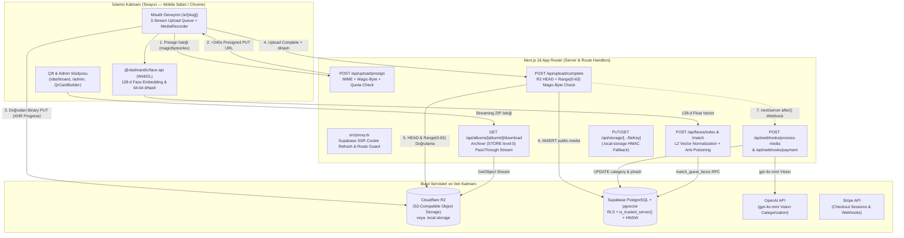

# PROJECT_OVERVIEW.md — Lumina (Mira'nın eski sürümü)

## 1. Proje Amacı ve Vizyonu
**Lumina** (`event-qr-studio`), düğün, nişan ve özel davetlerde misafirlerin hiçbir mobil uygulama indirmeden veya hesap oluşturmadan masalardaki 300-DPI QR kartlarını okutarak **orijinal (sıkıştırmasız 4K) fotoğraf, video ve sesli mesaj (Voice Toast)** paylaşmasını sağlayan; aynı zamanda **cihaz içi (on-device WebGL) 128-boyutlu biyometrik yüz tanıma (`pgvector`)** ile her misafirin yalnızca kendisinin yer aldığı fotoğrafları keşfetmesine olanak tanıyan uçtan uca şifreli/imzalı bir bulut albüm platformudur.

---

## 2. İş Modeli ve Temel Kullanım Senaryoları (Use Cases)

### 2.1. Rol Bazlı Aktörler
1. **Düğün Çifti / Etkinlik Sahibi (`Owner` — `albums.owner_id`):**
   - Supabase Auth üzerinden kayıt olur (`/login`).
   - Hesap başına en fazla **5 farklı etkinlik albümü** (`MAX_ALBUMS_PER_ACCOUNT = 5` — örn. *Welcome Dinner, Ceremony, Reception, After Party, Sunday Brunch*) oluşturabilir (`/dashboard`).
   - **High-DPI QR & Table Card Studio** (`src/components/QrCardBuilder.tsx`) ile 5×7 inç 300-DPI (`1500 × 2100 px`) baskıya hazır masa kartları ve vektörel SVG/PNG QR kodları üretir.
   - **Visual Event Flow & Screen Studio** (`/admin/events/[albumId]/builder`) ile misafir karşılama adımlarını, tema renklerini, yazı tiplerini ve özellik anahtarlarını (`FeatureToggles`) canlı iPhone 16 Pro önizlemesiyle özelleştirir.
   - Yüklenen medyaları denetler (`hide`/`unhide`, kategori değiştirme, kalıcı silme), `phash` tabanlı kopya (burst) fotoğrafları temizler ve tüm albümü **Zero-RAM Streaming ZIP** (`/api/albums/[albumId]/download`) olarak indirir.
2. **Yardımcı Ev Sahipleri (`Co-Host` — `public.co_hosts`):**
   - Albüm sahibi tarafından e-posta adresiyle davet edilir.
   - Doğrulanmış JWT e-postası (`auth.jwt() ->> 'email'`) eşleştiğinde `public.can_manage_album(album_id)` fonksiyonu üzerinden albümdeki medyaları görüntüleme, gizleme/onaylama, kategorize etme ve ZIP indirme yetkisine sahip olur (ancak başka co-host ekleyemez/çıkaramaz).
3. **Misafir (`Guest` — Anonim + `eqr_guest_session` HttpOnly Cookie):**
   - Masadaki QR kodu okutarak `/e/[slug]` (veya `/e/[slug]?table=12`) adresine gelir.
   - Etkinliğin `flow_config.steps` sırasına göre:
     1. `welcome_splash`: Karşılama ekranı.
     2. `guest_registration`: Dijital misafir defteri (Ad, Masa No, GDPR/KVKK onaylı WhatsApp/E-posta).
     3. `biometric_opt_in`: Kamera ile anlık selfie taraması veya galeriden selfie seçimi (`FaceScannerModal`).
     4. `main_hub`: Fotoğraf/video yükleme, sesli mesaj (`MediaRecorder`) kaydetme, kendi yüklediklerini (`my_uploads`) görme ve yüz eşleşmelerini (`find_me`) inceleme.
4. **Platform Süper Yöneticisi (`Super Admin` — `profiles.is_super_admin` veya `app_metadata.is_super_admin`):**
   - `/admin` (`MasterSuperAdminDashboardPage`) üzerinden tüm kiracıların (multi-tenant) etkinliklerini, toplam Cloudflare R2 depolama kullanımlarını, indekslenen yüz vektörü sayılarını ve misafir kayıtlarını izler.
   - B2B/VIP müşteriler için manuel ödeme/paket aktivasyonu (`PATCH /api/admin/events`), başarılı bir etkinliğin akış/tema ayarlarını yeni müşteriye klonlama (`POST /api/admin/events`) ve etkinlikleri R2 nesneleriyle birlikte kalıcı silme (`DELETE /api/admin/events`) yetkisine sahiptir.

### 2.2. Paket Kademeleri (`PlanTier`) ve Ödeme Modeli
`src/lib/payments.ts` içindeki `PLAN_CATALOG` üç kademe tanımlar:
- **`starter` ($29 — Starter Event Pass)**
- **`pro` ($69 — Pro Celebration Suite)**
- **`unlimited` ($99 — Unlimited Multi-Event Bespoke)**

> [!NOTE]
> `src/lib/media-config.ts` içerisinde tüm paketlerde (`starter`, `pro`, `unlimited`) dosya başı boyut sınırları aynıdır (`photo`: 50 MiB, `video`: 2048 MiB, `audio`: 200 MiB) ve albüm kotaları 100.000 öğe / 1.000 GiB olarak kısıtlamasız tanımlanmıştır. Ödeme alındığında (`POST /api/webhooks/payment`) albümün `expires_at` süresi düğün tarihinden (`event_date` veya `now()`) itibaren **24 ay** uzatılır (`computePostEventExpiration`).

---

## 3. Ana Mimari Prensipler ve Güvenlik Mandatları

1. **Zero-Proxy Direct-to-R2 Upload (Sıfır Sunucu Bant Genişliği):**
   - Medya baytları **asla** Next.js sunucusundan geçmez (yerel geliştirme fallback'i hariç). Tarayıcı `/api/upload/presign` ile `< 300 saniye` (`PRESIGN_TTL_SECONDS = 240`) geçerli imzalı PUT URL'i alır, doğrudan Cloudflare R2'ye yükler ve `/api/upload/complete` ile kaydı tamamlar.
2. **Zero Public Gallery Mandate (Sıfır Açık Galeri Kuralı):**
   - Standart misafirler **asla** diğer misafirlerin yüklediği fotoğrafların açık bir akışını göremez (`GET /api/events/[slug]` yalnızca misafirin kendi imzalı oturumuna ait `myUploads` listesini döner).
   - Bir misafir diğer misafirlerin çektiği fotoğrafları **yalnızca** kendi yüzünü taratarak (`POST /api/faces/match` -> `match_guest_faces` pgvector RPC, varsayılan kosinüs benzerliği eşiği `0.82`, minimum `0.78`) görebilir.
3. **GDPR / KVKK Biyometrik Gizlilik (Client-Side WebGL Extraction):**
   - Misafirin selfie görüntüsü asla sunucuya yüklenmez ve `localStorage`'a yazılmaz (`GUEST_FACE_EMBEDDING_STORAGE_KEY` her açılışta aktif olarak temizlenir). `@vladmandic/face-api` tarayıcıda 128-boyutlu `Float32Array` vektörü çıkarır ve yalnızca L2-normalize edilmiş matematiksel vektör eşleştirme için kullanılır.
4. **Disposable Camera Mode (Şipşak Kamera Modu):**
   - `albums.reveal_at` ileri bir tarih/saate ayarlandığında misafirler gece boyunca fotoğraf/video yüklemeye devam edebilir ancak yüz arama (`match_guest_faces`) kilitlenir ve geri sayım sayacı gösterilir.
5. **Çift Katmanlı Magic-Byte Doğrulaması:**
   - Yüklenen dosyaların uzantısına veya tarayıcının bildirdiği MIME tipine güvenilmez. İlk 32-64 baytlık ikili dosya başlığı (`detectMimeFromMagicBytes`) hem `presign` aşamasında istemciden gelen hex ile hem de `complete` aşamasında R2'den `Range: bytes=0-63` okunarak doğrulanır.

---

## 4. Yüksek Seviyeli Sistem Mimarisi Şeması

---

## 5. Gelecek AI Ajanları İçin Kritik Uyarılar (Edge Cases & Gizli Kurallar)

> [!CAUTION]
> **Next.js 16 Breaking Changes (`AGENTS.md` & `src/proxy.ts`):**
> Bu proje **Next.js 16.4.5** ve **React 19.3.0** kullanmaktadır. Next.js 16'da eski `middleware.ts` yerine **`src/proxy.ts`** (`export async function proxy(request: NextRequest)`) kullanılmaktadır. Kesinlikle `middleware.ts` oluşturmayın veya `src/proxy.ts` dosyasını silmeyin!

> [!WARNING]
> **Sıfır Açık Galeri Kuralını İhlal Etmeyin (`ZERO PUBLIC GALLERY MANDATE`):**
> Misafir sayfasında (`/e/[slug]`) tüm fotoğrafları listeleyen genel bir "All Photos" sekmesi **bilinçli olarak yoktur** (`type GalleryTab = "find_me" | "my_uploads"`). `GET /api/events/[slug]` uç noktasına asla tüm albüm medyalarını döndüren bir sorgu eklemeyin.

> [!IMPORTANT]
> **Demo Modu (Zero-Config Fallback) Davranışı:**
> Proje, `.env.local` içinde Supabase, R2, Stripe veya OpenAI anahtarları tanımlanmamış olsa bile kırılmadan çalışacak şekilde tasarlanmıştır:
> - Oturum açılamazsa `getAuthenticatedActor()` otomatik olarak `DEMO_OWNER_ID` (`00000000-0000-4000-8000-000000000099`, `isDemoFallback: true`) döner.
> - Cloudflare R2 yapılandırılmamışsa (`isR2Configured() === false`), sistem otomatik olarak `.local-storage/event-qr-media` dizinini ve HMAC-SHA256 imzalı `/api/storage/[...fileKey]` rotalarını kullanır.
> - Bu fallback mekanizmalarını "gereksiz mock kod" sanarak silmeyin; yerel geliştirme ve otomatik doğrulama testleri bu katmana bağlıdır.
